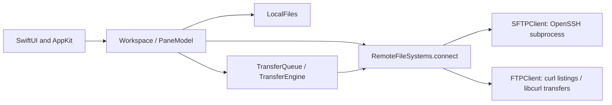

# Developer guide

A quick map of the codebase, reflecting FTP implementation step 3. Start with [README.md](README.md) for builds and usage; [VALIDATION.md](VALIDATION.md) records checks actually performed.

## How the pieces fit

SwiftUI owns the application layout; AppKit implements the native file tree. Main-actor models hold UI state and dispatch blocking filesystem/network work to worker tasks. Both remote protocols share one file-operation interface.

The diagram shows responsibility and session creation. File operations run through `RemoteFileSystem`; backends do not depend on views. App commands use `focusedSceneObject` / `FocusedObject` to observe the active workspace, so published tab changes immediately update shortcut availability. A tab owns its two panels, not a permanent network connection. Remote operations generally open their own session/request and explicitly close it.

## Source file map

All Swift files below are in [`Sources/BasedFTP/`](Sources/BasedFTP/).

| File | What it contains |
| --- | --- |
| [main.swift](Sources/BasedFTP/main.swift) | App entry point, window setup, commands, and shutdown cancellation. Also runs the short-lived SSH ASKPASS helper when OpenSSH invokes the executable. |
| [Workspace.swift](Sources/BasedFTP/Workspace.swift) | `RootView`, connection tabs, active-panel state, bookmarks, drag payloads, and application menu commands. `Workspace` coordinates panels, transfers, and editing sessions. |
| [Models.swift](Sources/BasedFTP/Models.swift) | Server profiles, protocol selection/capabilities, file metadata, navigation history, conflict policies, and errors. Older profiles decode as SFTP. |
| [ProfileEditor.swift](Sources/BasedFTP/ProfileEditor.swift) | Server form, connection testing, SSH host-key discovery/verification, and the explicit trust dialog. |
| [FilePane.swift](Sources/BasedFTP/FilePane.swift) | Panel toolbar, paths/breadcrumbs, search, action dialogs, file opening, plus queue rows and the status bar. |
| [FileOutlineView.swift](Sources/BasedFTP/FileOutlineView.swift) | SwiftUI/AppKit bridge around `NSOutlineView`; tree nodes, row selection, double click, sorting, native drag/drop, and context menus. |
| [FileSystem.swift](Sources/BasedFTP/FileSystem.swift) | `LocalFiles` helpers and `PaneModel`: navigation, lazy folder loading, filtering/sorting, selection, and file operations. |
| [RemoteFileSystem.swift](Sources/BasedFTP/RemoteFileSystem.swift) | Shared backend contract, transfer feature flags, deletion progress, convenience methods, and the SFTP/FTP connection factory. |
| [SFTP.swift](Sources/BasedFTP/SFTP.swift) | Binary SFTP v3 packets, OpenSSH process/session handling, pipelined requests, file operations, and atomic editor uploads. SSH encryption/authentication belongs to OpenSSH. |
| [FTP.swift](Sources/BasedFTP/FTP.swift) | FTP path/URL validation, MLSD parsing, curl-based directory requests, regular-file transfers, and staging-file commits. Unavailable operations throw explicit errors. |
| [FTPCurl.swift](Sources/BasedFTP/FTPCurl.swift) | Direct system-libcurl requests and file/progress/seek callbacks. Handles binary I/O, cooperative pause/cancel, timeouts, and safe callback lifetimes. |
| [OperationControl.swift](Sources/BasedFTP/OperationControl.swift) | Shared cancellation/pause state, subprocess attachment and inactivity checks, native callback checkpoints, and global cancellation on exit. |
| [Transfers.swift](Sources/BasedFTP/Transfers.swift) | Queue scheduling, job state, conflict handling, recursion, staging, resume checkpoints, byte/file counters, warnings, and readable remaining time. |
| [RemoteEdit.swift](Sources/BasedFTP/RemoteEdit.swift) | Working copies, stable SHA256 snapshots, change monitoring, serialized automatic uploads, retry/stop, and editing status views. Available for SFTP only. |
| [EditorApplications.swift](Sources/BasedFTP/EditorApplications.swift) | Installed editor discovery, Open With menus, opening files, and BasedFTP-only per-extension preferences. |
| [Security.swift](Sources/BasedFTP/Security.swift) | `CredentialStore` for Keychain access and `ProfileStore` for secret-free profile JSON, favorites/recents, and SSH alias import. |

[`Sources/CCurl/`](Sources/CCurl/) contains the system-library module map and [`CCurl.h`](Sources/CCurl/include/CCurl.h). Its small typed adapters let Swift call libcurl's variadic configuration API. It contains no FTP implementation or bundled libcurl source.

## Functions to know first

| Entry point | What it does |
| --- | --- |
| `Workspace.connect(_:)` / `closeSelectedTab()` | Creates a tab and loads both panels, or closes the selected tab and cancels its panel operations. |
| `Workspace.transfer(from:entries:)` / `drop(_:to:directory:)` | Routes a selection to the queue or a same-panel move, checking current protocol restrictions. |
| `PaneModel.navigate(_:record:)` | Resolves and lists a directory, updates history/UI state, and rejects stale results using a generation token. |
| `PaneModel.toggleExpanded(_:)` → `loadChildren(_:)` | Expands/collapses a tree branch and loads children asynchronously. |
| `PaneModel.perform(_:)` | Runs a file mutation outside the UI actor, reports errors, and refreshes afterward. `create`, `rename`, `move`, `deleteSelection`, and `chmod` build on it. |
| `RemoteFileSystems.connect(profile:control:knownHosts:)` | Selects the backend. Callers use `defer { client.close() }`; sessions are used serially on a worker task. |
| `TransferQueue.enqueue(...)` → `pump()` | Creates jobs and starts workers up to the parallel limit. `pause`, `cancel`, and `retry` control their lifecycle. |
| `TransferEngine.run(...)` → `measure(_:)` / `transfer(...)` | Refreshes source metadata, counts work, applies conflicts, transfers through staging files, and saves resume information. |
| `SFTPClient.issue(...)` / `response(_:)` | Sends numbered protocol requests and matches/buffers replies, including out-of-order responses. |
| `FTPListing.parse(_:directory:)` / `FTPPaths.fileURL(...)` | Converts MLSD facts to `FileEntry` and encodes file URLs without allowing command injection. |
| `FTPCurl.perform(...)` | Configures and executes one native FTP transfer or staging-rename request; its callbacks report bytes and check operation control. |
| `RemoteEdit.start(...)` → `checkForChanges()` → `pump()` | Downloads/opens a working copy, detects stable saves, and uploads the latest pending immutable snapshot. `retry()` uses the latest local version; `stop()` retains recovery files. |
| `HostTrust.scan(_:)` / `trust(_:)` | Discovers fingerprints for independent verification, then appends explicitly approved new keys without replacing existing keys. |

`FTPError` is the historical shared error type: its `.status` case carries **SFTP** status codes. Higher layers use `entryIfExists(_:)` rather than interpreting those codes; only confirmed absence returns nil, while access/network errors throw.

## Three common paths through the app

**Open a folder:** `FilePane` or the outline coordinator → `PaneModel.navigate` → `LocalFiles` or the remote factory → `realpath`/`list` → published panel state. Expanding a folder uses the separate lazy child-loading path.

**Transfer a file:** panel/button/drop → `Workspace` → `TransferQueue` → worker creates a backend → `TransferEngine.run` → backend `upload`/`download` → staging commit → progress/job state and panel refresh. Queue scheduling and conflict decisions belong in `Transfers.swift`; wire-level behavior belongs in the backend.

**Save a remote edit:** file opening → `RemoteEditManager.open` → `RemoteEdit.start` → preferred editor → stable local snapshots → `RemoteFileEditBackend` → `uploadEditingSnapshot`. This requires atomic SFTP replacement; normal FTP transfer support does not enable remote editing.

## Rules worth preserving

- UI state lives on the main actor. Blocking I/O runs on workers; a backend session is not a concurrently shared client. `OperationControl` and `TransferCheckpoint` synchronize their shared state.
- A fresh upload writes a staging file before commitment. SFTP editor uploads require atomic replacement. FTP uses RNFR/RNTO and never deletes the old destination as a fallback; FTP cannot promise atomic replacement or race-free no-replace semantics.
- Resume assumes matching partial contents; it does not compare prefixes. Checkpoints and queue state are in memory. Recovery files may remain after failure/restart.
- `ServerProtocol` controls UI availability; `RemoteTransferFeatures` tells the engine about directory/permission support. Update both when implementing a capability, and keep backend checks as protection against direct calls.
- Passwords/passphrases belong in Keychain, not profile JSON. FTP has a separate password entry. Preserve strict SSH host-key verification and keep credentials out of arguments, logs, and files.

## Where to make a change

| Task | Start here |
| --- | --- |
| Panel layout, buttons, status text | `FilePane.swift`; overall window/tabs in `Workspace.swift` |
| Tree selection, context menus, native drops | `FileOutlineView.swift`; routing in `Workspace.drop` |
| Navigation, filtering, stale listings | `PaneModel` in `FileSystem.swift` |
| Queue behavior, conflicts, file counts, resume | `Transfers.swift` |
| FTP folders and file operations (next step) | `FTP.swift`, backend feature flags, `ServerProtocol`, then UI gates and real-server tests |
| Editor monitoring or Open With | `RemoteEdit.swift` / `EditorApplications.swift` |
| Authentication/profile storage | `Security.swift`, `ProfileEditor.swift`, protocol-specific backend |

## Build tools and tests

[`Package.swift`](Package.swift) and [`BasedFTP.xcodeproj`](BasedFTP.xcodeproj/) use the same Swift sources. After adding/removing a Swift file, run `python3 Scripts/generate-project.py`; avoid edits to generated project settings without updating that script too.

| Script | Purpose |
| --- | --- |
| [build-app.sh](Scripts/build-app.sh) | Builds arm64/x86_64 release slices, combines them, copies resources/license, and signs/verifies `build/BasedFTP.app`. |
| [test.sh](Scripts/test.sh) | Runs SwiftPM tests. Network integration tests explicitly skip when their servers are not configured. |
| [integration-test.sh](Scripts/integration-test.sh) | Starts isolated loopback SSH tests and additional key variants. |
| [ftp-integration-test.sh](Scripts/ftp-integration-test.sh) | Starts isolated pyftpdlib servers; accepts a command for combined FTP/SSH runs. Test-only installation steps are in the README. |
| [render-icon.swift](Scripts/render-icon.swift) | Generates the app icon assets. |

Tests live in [`Tests/BasedFTPTests/`](Tests/BasedFTPTests/): `CoreTests` covers protocol/security and SFTP operations; `RemoteFileSystemTests` the shared contract; `TreeTests` navigation/moves; `WorkspaceTests` tabs/bookmarks; `RemoteEditTests` snapshots/automatic editing; `FTPTests` profiles/listing/gates; `FTPTransferTests` transfers/recovery/queue behavior. [`Tests/Fixtures/`](Tests/Fixtures/) holds the real FTP test-server setup and a test-only SFTP reordering/short-read fixture.

[`Resources/`](Resources/) holds icons/screenshots. [`docs/index.html`](docs/index.html) and [the Pages workflow](.github/workflows/pages.yml) are the separate static landing page. `.build/` and `build/` contain generated artifacts and are ignored by Git. Consult the validation report for the known local Xcode plugin issue and runtime coverage limits.
