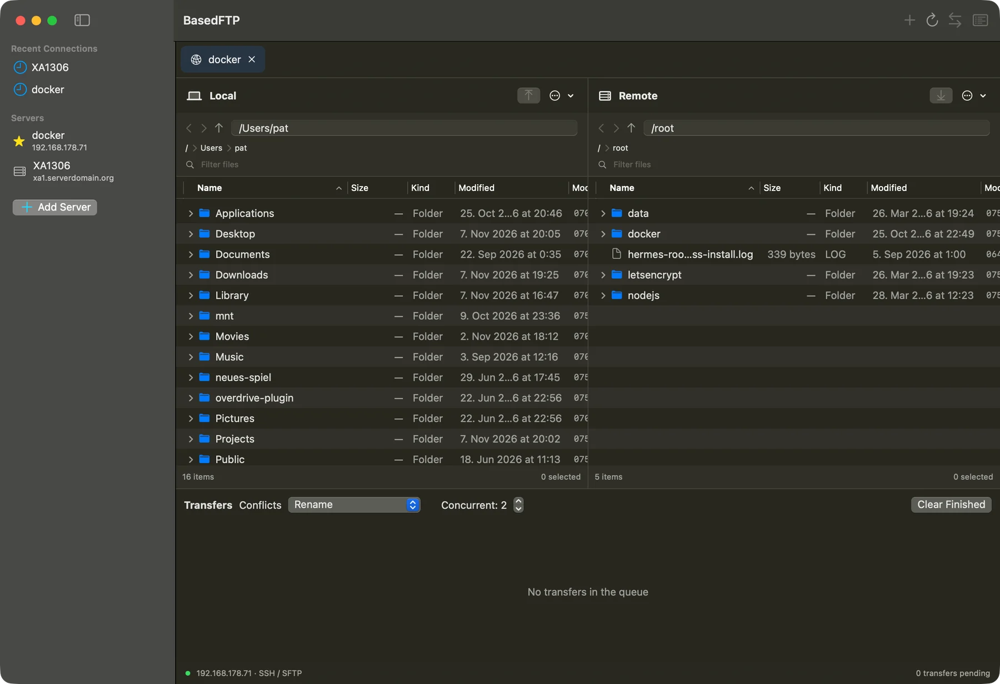

# BasedFTP

**Your server files. Right at home on your Mac.**

BasedFTP is a free, open-source SFTP client for macOS, with FTP and FTPS support too. Browse local and remote files side by side, drag and drop to transfer, and edit server files in your favorite editor—with automatic uploads when you save. Native Mac feel. No accounts, ads, or telemetry.

**[Download for Mac](https://github.com/patrickzach/BasedFTP/releases)** · [Visit the website](https://patrickzach.github.io/BasedFTP/)



Requires macOS 14 or later. Universal app for Apple Silicon and Intel. Built with SwiftUI and AppKit, without external package dependencies. This is an early release; see the validation notes and limitations below.

Features and improvements are documented in the [Changelog](CHANGELOG.md). For a quick map of the source files, key functions, and execution paths, see the [Developer guide](DEVELOPMENT.md).

## Interface language

BasedFTP defaults to English, including on Macs configured in German. App menus, dialogs, status indicators, and error messages are in English. Date and number formats, as well as operating system or server messages, may still follow their respective regional settings or language. Saved profile names and filenames remain unchanged. A separate German localization is not currently included.

## Building and running

Requirements: Xcode with the macOS SDK and Swift 6 or later. The build script produces a universal app for Apple Silicon (`arm64`) and Intel (`x86_64`). Both variants have compiled successfully; the app has not yet been tested on Intel hardware.

- Run `bash Scripts/setup-local-signing.sh` once to create a reusable **BasedFTP Local Development** signing identity in your login Keychain. macOS may request permission for this setup. It trusts that certificate for code signing only, never for TLS. Keep this identity across builds.
- Open `BasedFTP.xcodeproj`, select the **BasedFTP** scheme and **My Mac** destination, then run.
- Alternatively, run `bash Scripts/build-app.sh`. This creates `build/BasedFTP.app` as a universal bundle (`arm64` + `x86_64`) with your reusable local certificate signature. Both architectures require macOS 14 or later. Launch the app in Finder afterward.
- `bash Scripts/keychain-integration-test.sh` checks two different signed app builds against a fixed helper and synthetic Keychain entries, with authorization dialogs disabled; mismatched caller signatures/identifiers must fail. It requires the signing identity above and an unlocked login Keychain.
- `bash Scripts/test.sh` runs unit tests and local SFTP subsystem tests.
- `bash Scripts/integration-test.sh` additionally starts a temporary SSH server **bound only to 127.0.0.1**, using a random port and dedicated keys. It does not change system or user SSH settings. Requirements: `/usr/sbin/sshd`, `/usr/libexec/sftp-server`, Python 3, and permission to access the loopback network. Test files and the agent are removed afterward.

Regenerate the project without additional tools using `python3 Scripts/generate-project.py`. The Swift package and Xcode project use the same source files. The build script also provides an alternative if the local Xcode IDE installation is broken.

## Keychain access and local updates

Saved passwords and passphrases remain in macOS Keychain. App bundles use a small signed `BasedFTPCredentials` helper for all credential reads, updates, and deletion. It checks the calling app's identifier **and signing certificate**; the app also verifies the helper's identifier and certificate. Requests and responses use private pipes, with no secrets in process arguments, environment variables, or temporary files.

Locally signed programs can receive a new Keychain partition identity when their executable changes, even with the same self-signed certificate. The build therefore preserves the helper executable under `~/Library/Application Support/BasedFTP/Signing/Helpers/` and copies those same signed bytes into new app bundles. The main app can change without changing the credential reader. Keep this cache and signing identity. Changing helper sources/build settings, deleting the cache, rotating the certificate, or moving to a differently signed distribution can require fresh approval.

**One-time transition:** existing credentials still belong to earlier builds. When macOS asks for the new helper's access, select **Always Allow** for the relevant entry. This may be needed separately for each saved password/passphrase. Entries are updated in place so password changes retain access grants; no existing credentials are automatically deleted or their permissions widened to all applications. Successful reads are serialized and cached in the app's memory until replacement, deletion, or app exit. SSH ASKPASS processes remain short-lived but use the same stable helper.

Set `BASEDFTP_SIGNING_IDENTITY` to an exact certificate name or SHA-1 to use another signing identity; use the matching identity in Xcode too. Missing identities fail the build rather than silently switching to ad hoc signing. `BASEDFTP_SIGNING_IDENTITY=- bash Scripts/build-app.sh` explicitly creates an ad hoc preview **without saved-credential support**. Direct SwiftPM command-line/test executables use Keychain APIs directly and do not provide the bundle's stable helper behavior. Self-signed local builds are not notarized distribution builds; never commit or share the private signing key.

## First SFTP connection

1. Add a server. The host can be a DNS name, IPv4 address, or alias from `~/.ssh/config`. For IPv6, use an SSH alias for now. Leave the username and port blank to use the OpenSSH configuration.
2. Select an SSH key or use your existing SSH agent. OpenSSH handles Ed25519, RSA with modern signatures, and ECDSA. Passphrase-protected keys can be unlocked through the agent or a passphrase stored in Keychain.
3. For password authentication, enter the password and leave the Keychain option enabled. Entering a secret visibly enables this option. To delete a stored secret, clear the field and enable the replacement option. Existing secrets are otherwise left unchanged.
4. For an unknown host, use the host-key verification action. Independently compare every offered SHA256 fingerprint with the administrator and explicitly confirm it. `ssh-keyscan` alone does not establish trust. Existing keys are never replaced here. Changed keys cause the connection to fail.
5. Test the connection, then connect. For a quick connection, turn off **Save server profile**.

For ProxyJump/ProxyCommand, verify host keys once using the standard OpenSSH client in Terminal. Subsequent SFTP connections support this configuration through OpenSSH. Import is available under **Connections → Import from SSH Configuration** and lists explicit host aliases from the main configuration file. Include files and wildcards are not expanded during import, but OpenSSH evaluates them normally when connecting.

## FTP browsing, transfers, and file operations (step 4)

Choose **FTP (Unencrypted)** in the server dialog. Enter a hostname or IPv4 address, username, password, optional port (default **21**), and initial directory (default **.**, the login directory). Use `anonymous` explicitly for anonymous access. **Test Connection** verifies login and a passive directory listing. FTP passwords have a separate Keychain entry from SFTP passwords; changing a profile's protocol does not reuse its SSH password.

You can browse directories, expand the folder tree, navigate with breadcrumbs/back/forward, sort, filter, and show hidden files. FTP sends credentials, listings, and file contents without encryption; use SFTP or FTPS for secure connections.

FTP uploads/downloads **files and recursive folder trees** through the shared queue, including parallel jobs, byte/file progress, speed/ETA, pause, cancellation, retry, and explicit Resume. Skip, Rename, and Overwrite conflicts work in both directions. Empty folders/files are included; recognized links and special files are skipped with warnings. Buttons, context menus, and the existing drag/drop routes support folder transfers as well as file transfers.

FTP file operations include folder/file creation, renaming, moving, recursive deletion, and manual permission changes through **SITE CHMOD** when the server supports it. Same-panel moves use the existing drag/drop and Move To routes. Existing destinations, moves into a folder's own descendants, mutation of `/`, and operations through detected link ancestors are rejected. New empty files are staged before renaming. FTP offers no portable exclusive-create/no-replace guarantee against concurrent clients. **Remote editing remains SFTP-only.**

Fresh uploads use uniquely named staging files. After the complete upload succeeds, FTP RNFR/RNTO commits the staging file. Overwrite requires server-side rename-over-existing support: if refused, the old file and staging file are retained; **there is no DELE fallback**. FTP does not guarantee atomic replacement or atomic no-replace behavior across servers. Existence checks reduce conflicts but cannot eliminate races with other clients. A lost rename acknowledgment can leave the old or new version; inspect the server before retrying. FTP remote editing therefore stays disabled. Downloads also use staging files before local commitment.

Resume requires an unchanged source and identical existing prefix; partial contents are not compared. FTP upload resumption appends from the retained size, and download resumption requires REST support. Unsupported or oversized partials fail explicitly. Failed/canceled jobs retain checkpoint paths while the app is open; leftover staging files may need manual recovery after restart. Very long pauses can cause server or libcurl timeouts.

FTP requires UTF-8 and RFC 3659 **MLSD** listings; legacy LIST-only servers receive an explanatory error. MLSD may follow symlinks, so the backend additionally reads **Unix-style LIST -a** metadata to identify actual links, including broken links, and display Unix permissions. Ambiguous or inconsistent metadata is not assumed safe. Verified link metadata is required for writes and recursive traversal; MLSD-only/non-Unix servers can still be browsed and explicitly selected regular files downloaded, but unsupported operations fail clearly. Inconsistent read-only metadata snapshots may be retried up to twice; mutations are not automatically repeated by the app.

Recursive FTP deletion uses acknowledged DELE/RMD commands over a reusable control connection, removes parents after their children, and shows the current path/confirmed count. It stops on error or cancellation, leaving remaining entries/parents in place. There is no shell command or upfront total count. Detection protects against known links and static loops, not every possible concurrent malicious filesystem change.

Downloads require a reported regular-file type and size so completion can be verified. Unknown permissions, sizes, and modification times display as **—**. Automatic FTP uploads do not attempt chmod; manual SITE CHMOD is explicit and may be refused by the server. Downloads without Unix permissions retain private local staging permissions rather than applying mode 0000. FTP paths use the server's virtual filesystem and are normalized lexically; they do not provide SFTP-style canonical symlink resolution. Control characters in FTP paths/credentials are rejected. Direct IPv6 literals are not supported in FTP profiles yet.

Listings use macOS `/usr/bin/curl`; transfers use the system **libcurl API** with a small typed C adapter, avoiding parsing human-readable progress output. No third-party runtime package is bundled or downloaded. Both negotiate passive EPSV/PASV, ignore foreign PASV addresses, bypass proxy settings, and use a 15-second connection timeout. Listings have a 60-second request limit and a 32 MiB cap. Transfers have 60-second low-speed/server-response timeouts instead of a total-duration cap. Listing credentials travel over stdin configuration; transfer credentials stay in memory. Arbitrary server diagnostics are not displayed or written to files. Native transfer callbacks provide byte progress, cooperative pause, and cancellation on worker threads; listing subprocesses use the existing process controller.

To run the real loopback FTP tests, install the **test-only** dependency (not bundled with the app):

```bash
python3 -m venv .build/ftp-test-venv
.build/ftp-test-venv/bin/python -m pip install pyftpdlib==2.2.0
bash Scripts/ftp-integration-test.sh
```

The script starts two isolated pyftpdlib servers bound only to `127.0.0.1`, using temporary directories and synthetic credentials, then cleans them up. To run the entire suite with both FTP and SSH servers available, use `bash Scripts/ftp-integration-test.sh bash Scripts/integration-test.sh`. `FTP_TEST_PYTHON` can select another Python installation with pyftpdlib installed. Without these servers, the network FTP tests are explicitly skipped.

## FTPS (FTP over TLS, step 5)

Choose **FTPS (Explicit TLS)** for the usual FTP-to-TLS upgrade, normally on port **21**. **FTPS (Implicit TLS)** starts TLS immediately and defaults to port **990**. Custom ports work in either mode. FTPS is separate from SFTP, which uses SSH.

Both modes require **TLS 1.2 or newer for control and data connections**, including listings, transfers, and file operations. The app verifies the server certificate chain, validity, and hostname. A server refusing TLS or protected data channels causes failure; there is no automatic switch to plain FTP, trust-all checkbox, or certificate-verification bypass. The status bar identifies explicit/implicit FTPS.

Leave **CA Certificate (optional PEM)** blank to use the platform/system-libcurl trust defaults. For a private CA, select a readable PEM CA bundle for that profile. The setting affects that profile's requests, not the macOS trust store. A custom CA does not disable hostname or expiration checks. The path is saved with the profile; the certificate is not uploaded. FTPS passwords use a separate Keychain entry from plain FTP and SSH, shared between the two FTPS modes of the same profile. Switching protocol clears unsaved credential fields.

FTPS shares FTP's recursive transfers, queue, conflicts, file operations, Unix LIST metadata requirements, and staging/rename limitations described above. TLS does not add atomic replacement semantics: remote editor auto-upload remains SFTP-only. Authentication is username/password; FTPS client-certificate authentication is not implemented.

Run the isolated TLS tests with test-only dependencies:

```bash
.build/ftp-test-venv/bin/python -m pip install pyOpenSSL==26.4.0
bash Scripts/ftps-integration-test.sh
```

This uses the Python environment and pyftpdlib installation from the FTP section. It generates an ephemeral private CA and local server certificates, binds only to loopback, checks trusted and invalid certificates on control/data channels, and cleans up without changing Keychain or system trust. To run all protocol tests together:

```bash
bash Scripts/ftps-integration-test.sh bash Scripts/ftp-integration-test.sh bash Scripts/integration-test.sh
```

## Usage

- Open saved servers and recent connections with a single or double click. A double click creates exactly one tab. The entire bookmark row is clickable.
- **⌘W** closes the active connection tab. After the last tab closes, the window remains open with the welcome screen. **⇧⌘W** closes the entire window.
- Two independently navigable file panels provide a movable divider, path entry, breadcrumbs, back/forward navigation, and double-click opening. Both use native NSOutlineView trees: expand folders using their disclosure arrows, with subfolders loaded asynchronously. Right/Left Arrow expands or collapses the selection. Refreshing preserves expanded branches.
- Native tables support multiple selection. Name, size, type, modification time, and octal permissions are visible. Select the sort field and direction using column headers or the panel menu. A search field filters the current directory locally by filename.
- Upload/download using panel buttons, the toolbar, context menus, **⌘T**, or **F5**. Drag files and folders between panels. Drop onto a destination folder to transfer directly into it. Dragging within the same panel **moves** items: drop onto folder rows, including collapsed folders, breadcrumbs, or empty space for the current directory. Moves never overwrite existing destinations; moving into the source itself or a descendant is rejected. Selected folders and their children are moved only once. Uploads from Finder into the remote panel are supported. Dragging remote files out to Finder is not yet implemented.
- **⌘R** refreshes the active panel, **⌘↑** opens its parent directory, **⌘[ / ⌘]** navigates back/forward, **⇧⌘.** toggles hidden files, **⇧⌘N** creates a folder, **⌘Return** renames the selection, and **⌘⌫** opens delete confirmation. Clicking or selecting determines the active panel.
- Context menus provide file/folder creation, renaming, moving to an absolute destination directory, chmod, and deletion. Local deletion uses Trash; confirmed remote deletion is permanent and recursive. For SFTP, up to 16 independent delete requests can be in flight; parent folders are removed only after their children. The panel shows the current path and number of acknowledged deletions. Cancellation cannot restore entries already removed.
- Each transfer shows “x of y files transferred” and the remaining file count. Files skipped because of conflicts are listed separately. Empty files count; directories and skipped links/special files do not. Estimated remaining time uses days, hours, minutes, and seconds, such as “10 minutes and 5 seconds”. The transfer view configures 1–8 parallel jobs and the conflict strategy for **newly added** jobs. The default is Rename. Overwrite, Skip, and explicit Resume are also available.
- Pause suspends SFTP/listing subprocesses or waits cooperatively inside native FTP transfer callbacks. Long pauses may cause server timeouts. Cancel terminates the subprocess or aborts the native request. Retry starts a new job with the same strategy. Resuming a failed/canceled job uses its retained staging files and remembers completed files while the app remains open.
- Double-click a remote file or choose **Edit Remote File**: BasedFTP downloads it in the background and opens it directly in the preferred application. No Finder detour or modal editing dialog is required.
- Right-click → **Open With** lists suitable installed applications and **Other Application…**. **Always Open With** saves a per-extension association, such as `.html` → VS Code. This applies only to BasedFTP, including local files; it does not change macOS/Finder defaults. **Use macOS Default** removes the BasedFTP association.
- **Simply save in your editor:** the app monitors the working copy and automatically uploads changes. The remote editing area shows monitoring, upload, success, or error status. Multiple edited files have separate working copies; reopening the same remote file in the same workspace reuses its active session.
- Uploads run sequentially from immutable snapshots. If you save again during an upload, the latest stable version is uploaded afterward. Intervening server changes are deliberately overwritten without a conflict prompt.
- Upload failures retain the edited working copy and failed snapshots. **Try Again** uses the latest local version. **Working Copy** reveals the file in Finder for recovery. **Stop** disables automatic uploading without deleting the local file.

## Architecture and technical decisions

- `Models.swift`: profiles, file metadata, navigation, and conflict strategies.
- `RemoteFileSystem.swift`: protocol-independent remote file operations and the central connection factory. Browsing, transfers, connection testing, and remote editing use this interface. SFTP is fully implemented; FTP supports browsing, recursive transfers, and file operations, with FTP/FTPS remote editing still deferred. Missing entries are distinguished from permission and connection failures inside each backend.
- `OperationControl.swift`: shared operation lifetime, cancellation, pause, and process timeout handling. The existing process-based implementation is retained.
- `FTP.swift`: shared FTP/FTPS backend with curl-backed passive browsing, UTF-8 MLSD parsing, safe URL/configuration construction, staged file transfers, and file/folder operations.
- `FTPTLS.swift`: mandatory listing TLS settings and consistent certificate/handshake diagnostics for CLI/native requests. Native TLS options and verification-result checks are in `FTPCurl.swift`.
- `FTPUnixListing.swift`: conservative Unix LIST metadata verification, link/type detection, and permission parsing alongside MLSD.
- `FTPCurl.swift`, `Sources/CCurl/`: typed system-libcurl integration, bounded binary file I/O, byte progress, pause/cancel callbacks, staging commits, and reusable FTP command connections.
- `SFTP.swift`: binary SFTP v3 framing and file commands over stdin/stdout of `/usr/bin/ssh -s … sftp`. No shell command chains, `ls` parsing, or custom SSH cryptography.
- `FileSystem.swift`: local file access and asynchronous panel view models with protection against stale navigation results.
- `Transfers.swift`: bounded parallel queue, recursive transfers, conflicts, progress, average speed, and estimated remaining time.
- `Security.swift`: macOS Keychain and secret-free JSON profiles in `~/Library/Application Support/BasedFTP/profiles.json`.
- `FileOutlineView.swift`: native AppKit tree with selection, drag sources, row-specific drop targets, column sorting, and context menus.
- `RemoteEdit.swift`: monitored editing sessions, stable SHA256 snapshots, serialized automatic uploads, and status display.
- `EditorApplications.swift`: native application selection and BasedFTP-specific per-extension associations.
- `Workspace.swift`, `FilePane.swift`, `ProfileEditor.swift`: SwiftUI views and connection state.

**SSH backend:** Instead of bundling an additional SSH library, the app uses Apple's maintained system OpenSSH. This provides an established SSH implementation without an external dependency and preserves compatibility with agents, `Include`, `Match`, IdentityFile, and ProxyJump. The app implements only SFTP v3 file commands, not transport encryption. [libssh2](https://github.com/libssh2/libssh2), also evaluated, would add a C build/distribution dependency. [SwiftNIO SSH](https://github.com/apple/swift-nio-ssh) describes itself as an SSH building block rather than a complete client and lists Ed25519/ECDSA in its documented asymmetric algorithm set. The requirement for RSA and existing OpenSSH configurations led to choosing the system client.

For SFTP, each navigation request, file operation, or transfer job uses its own SSH subsystem process. Canceling one job therefore does not affect other connections. There is currently no persistent, app-managed connection pool or automatic retry of write operations. Retry reconnects. User-configured OpenSSH multiplexing settings may still apply.

Protocol I/O runs outside the Main Actor. The interface receives throttled progress updates. Transfers use 64 KiB blocks with up to eight outstanding requests. Response IDs are checked, out-of-order responses buffered, and short server reads completed. Cross-connection bandwidth limiting and adaptive window sizes are not currently implemented.

References consulted during implementation:

- [OpenSSH SFTP client and capabilities](https://man.openbsd.org/sftp)
- [OpenSSH configuration and precedence](https://man.openbsd.org/ssh_config)
- [SFTP v3 protocol](https://www.ietf.org/archive/id/draft-ietf-secsh-filexfer-02.txt)
- [OpenSSH SFTP extensions](https://github.com/openssh/openssh-portable/blob/master/PROTOCOL)
- [curl options and FTP behavior](https://curl.se/docs/manpage.html)
- [curl FTP URL syntax](https://curl.se/docs/url-syntax.html)
- [RFC 3659 MLSD directory listings](https://www.rfc-editor.org/rfc/rfc3659.html)
- [libcurl transfer progress callbacks](https://curl.se/libcurl/c/CURLOPT_XFERINFOFUNCTION.html)
- [libcurl FTP upload resumption](https://curl.se/libcurl/c/CURLOPT_RESUME_FROM_LARGE.html)
- [libcurl mandatory TLS for all FTP channels](https://curl.se/libcurl/c/CURLOPT_USE_SSL.html)
- [libcurl certificate and hostname verification](https://curl.se/libcurl/c/CURLOPT_SSL_VERIFYPEER.html)
- [curl explicit and implicit FTPS](https://curl.se/docs/faq.html#FTPS_does_not_work)

## Security and limitations

- `StrictHostKeyChecking=yes`, no agent forwarding, LocalCommand execution, or port forwarding. The app enforces `~/.ssh/known_hosts` and `/etc/ssh/ssh_known_hosts`; alternative KnownHosts paths from SSH configuration are deliberately ignored. Automatic DNS-based host-key acceptance and automatic key updates are disabled.
- Passwords and passphrases are stored only in macOS Keychain. FTP and FTPS use distinct credential entries. For SFTP, a dedicated, short-lived ASKPASS subprocess supplies them to OpenSSH through a pipe. FTP uses a separate password entry and supplies credentials to curl over stdin. Secrets are absent from process arguments, environment variables, profile JSON, and logs. Private keys remain at their existing locations.
- Profile names and filenames are never executed as shell code. Hosts and ports are validated, and protocol packets have size limits. SFTP supports UTF-8 filenames, including spaces, quotes, Unicode, and newlines. FTP rejects control characters, including newlines. Non-UTF-8 filenames are explicitly rejected.
- New SFTP transfers first write a uniquely named `.partial` file in the destination folder. It is committed only after successful completion. OpenSSH servers use `posix-rename@openssh.com`; overwriting after a completed upload is not atomic on servers without this extension. Hidden staging files may remain after failures and require manual cleanup.
- **Resume** writes directly into the existing destination file. Use it only with an identical prefix: SFTP v3 cannot guarantee a content comparison of existing partial data. A larger destination file causes failure. Retry retains the original strategy. Resume on a canceled job uses its saved staging paths; after restarting the app, leftover staging files must be identified/renamed manually. First ensure the source is unchanged.
- Symlinks and special files are individually skipped during uploads/downloads, allowing recursive transfers to continue without following links. The queue shows their count and full paths under **items skipped – Details**; successful jobs with skipped entries display **Completed with Warnings**. Navigation to a known destination path remains possible. There is no complete protection against concurrent malicious filesystem changes.
- **Automatic remote editing only replaces files atomically:** the new version is uploaded completely into an exclusively created staging file in the same server directory, then committed using `posix-rename@openssh.com`. If the server lacks this extension or the target is not a regular file, the operation fails with an explanatory error. Remote editing has no delete-and-rename fallback. If the connection drops after renaming, acknowledgment may be lost; the server then contains either the old or the complete new file. There is no version comparison or backup history: intervening changes are deliberately overwritten.
- Editing sessions check local metadata approximately every 700 ms. On changes, two stable content observations are compared using SHA256; snapshots protect active uploads from subsequent local modifications. Atomic editor saves are detected too. Large unchanged files are not continuously rehashed.
- Working copies are retained in private directories under `~/Library/Application Support/BasedFTP/Edits/<session-ID>/`. Failed server staging files may require manual cleanup. Monitoring ends when the window/app closes and is not yet restored automatically after restart. Closing a connection tab keeps its still-visible editing session active. Unix rwx permissions are preserved; ownership, ACLs, and other metadata are not yet fully preserved.
- The queue and open tabs do not survive app restarts. Directory synchronization, directory comparison, bandwidth limiting, and Quick Look are not implemented.
- The app is intended for local builds and direct use, currently without App Sandbox, a distribution signature, or notarization. It has no App Store approval. Access to macOS-protected folders follows normal system permissions.

## Validation of this version

See [VALIDATION.md](VALIDATION.md) for details and checks actually performed. Password authentication and the Keychain/ASKPASS chain additionally require an interactive test with a suitable test account; they are implemented but not claimed as fully tested end to end. Large production directories, hours-long transfers, different third-party servers, and older macOS versions need further practical testing before this version can be considered a professionally hardened 1.0.

## Landing page (GitHub Pages)

The prebuilt landing page lives in `docs/index.html`. It includes its styles and images, so no Node.js or Astro build is required in this repository.

1. In the GitHub repository, open **Settings → Pages** and select **GitHub Actions** as the source.
2. Push the changes to `main`. The **Deploy landing page** workflow publishes changes to `docs/` or the workflow itself. It can also be run manually from the Actions tab.
3. The default site address is https://patrickzach.github.io/BasedFTP/.

To update the page, replace `docs/index.html` with a fresh export from the landing-page project, commit, and push. The workflow uploads only `docs/`, not app sources or build artifacts.

## License

Copyright (C) 2026 Patrick Zach.

BasedFTP is licensed under the **GNU General Public License, version 3 only** (`GPL-3.0-only`). See [LICENSE](LICENSE) for the full terms.

You may use, modify, redistribute, and sell the software. When distributing modified versions or binaries, you must comply with GPLv3, including providing the corresponding source code under GPLv3. Private modifications do not require publication. The software is provided without warranty, to the extent permitted by applicable law.

When distributing an app build, include this license and make the corresponding source for that exact build available in a GPLv3-compliant manner. A link to a changing branch alone is not a substitute for the corresponding source of the distributed version.
